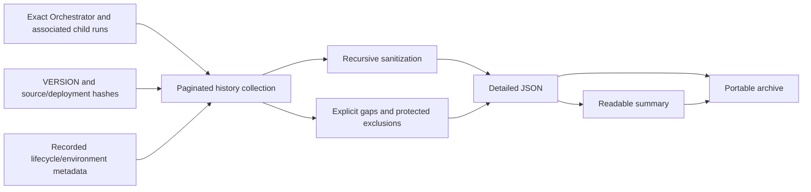

# Portable SCIM validation reporting

## Executive summary

This reporting change is dependent on the authentication-first change
documented in [Authentication-Changes.md](Authentication-Changes.md).
Authentication must be reviewed and merged first. This increment does not
change authentication policy, token transport, workflow definitions, or
functional test semantics.

[VERSION](VERSION) advances from the authentication baseline 14.0 to 15.0,
and `LogicAppVersion` is synchronized. Historical reports keep their original
executed/source versions and hashes; a source version bump does not certify
or relabel an earlier deployment.

## Scope

| Surface | Reporting enhancement |
|---|---|
| Canonical agent | Create a unique run folder before questions/cloud operations; record actual lifecycle events. |
| Exporter | Collect exact-run metadata, semantic results, timing, failures, and supported nested histories. |
| Portable output | Sanitized JSON, Markdown, and optional ZIP in separate exact-run/versioned folders. |
| Provenance | Distinguish source, executed version, deployed overlay, hashes, and caller claims. |
| Completeness | Expose required/optional gaps, protected payloads, and intentionally uncollected successful polls. |
| Recovery | Checkpoint sanitized evidence, resume only the same run, and finalize metadata offline when appropriate. |
| Tests | Dependency-free offline reporter tests and agent startup-folder regression coverage. |

All seven runtime workflow JSON files remain byte-identical to the
authentication baseline. The only parameter-template change is the bundle
version. Authentication is not implemented again in this PR.

## Evidence flow



The exporter must never select the newest run as a substitute for exact
association, infer hidden model settings, invent timestamps, disable token
protection, or turn missing required evidence into success.

## Data transformations and outcomes

| Input | Transformation / boundary |
|---|---|
| Azure timestamps | Normalize UTC and calculate available durations; preserve unavailable timing explicitly. |
| Inputs, outputs, errors, nested JSON | Recursively redact credentials and known secret literals before persistence. |
| Authorization headers and token payloads | Omit or mask; protected runtime payloads stay protected. |
| URL query values | Omit credential-bearing query content. |
| Source VERSION | Record value and hash separately from the version observed in run output. |
| Parent/child evidence | Keep exact verified associations; label weaker correlation claims. |
| Hidden runtime/model settings | Null plus a reason, not guessed values. |
| Typed null, empty string, false, zero | Preserve collected values rather than treating false-like values as missing. |
| JSON arrays embedded in strings | Preserve empty/singleton arrays and nested typed values while recursively redacting their contents. |
| OAuth `code` assignments in embedded JSON text | Apply the same conservative masking as textual logs, without matching diagnostic `statusCode` or `errorCode` fields. Typed runtime diagnostic codes remain intact. |
| Protected action/repetition payloads | Count recorded security exclusions across triggers, actions, and every repetition level, separately from hidden child mappings and evidence gaps. |

Azure runtime status, semantic test result, authentication result, evidence
completeness, and gallery readiness are different facts. A successful export
does not establish readiness; a complete report can legitimately be NotReady.

The default `FailureFocused` scope preserves every available action and
repetition's metadata, timing, status, errors, and retries. It collects
top-level payloads, failed/timed-out/cancelled repetitions, successful
semantic-result producers, and child-workflow calls. Repetitive successful
poll payloads are explicitly `NotCollectedByScope`, not failed downloads.
Completeness is defined within that declared scope.

## Collection and recovery lessons

| Observed issue in earlier combined development | Reporting response |
|---|---|
| Long exports outlived cached ARM credentials | Refresh by expiry and perform one bounded authentication retry. |
| Until repetition routes returned 404 | Collect supported nested-action repetitions and container metadata instead. |
| Repeated checkpoint sanitization dominated execution | Sanitize incrementally and batch checkpoint saves. |
| Successful polling payloads caused excessive requests | Preserve metadata without downloading redundant successful poll payloads. |
| Valid empty Compose outputs appeared missing | Preserve typed values and require corroboration for any legacy offline correction. |
| `code` masking also matched diagnostic status/error labels | Bound OAuth-code matching while preserving diagnostic status codes. |
| Metadata-only refresh repeated an expensive ARM pass | Reuse a complete immutable report and supported offline writer/event functions. |
| Concurrent workers replaced cleanup inventories | One writer per run folder; preserve snapshots, scope, and count differences instead of inventing lost history. |

An empty JSON string is present evidence, not evidence that a download
failed. A protected token is a security exclusion, not a request to remove
security settings. Neither correction changes functional test results.

Offline regression review also corrected embedded JSON array unwrapping,
an embedded-JSON bypass of textual OAuth-code masking, and an exclusion-summary
undercount that omitted protected repetitions. These fixes affect newly
generated reports only; frozen reports and their original counts, hashes,
versions, and outcomes must not be rewritten.

## Verification and limits

Run:

```powershell
.\Test-Authentication.ps1
.\Test-ScimValidationReport.ps1
```

The reporter tests use synthetic fixtures and no Azure calls. A fixture
VERSION or historical deployed version is not the current bundle version.
Validate source/version equality, LF bytes, links, exact-run association,
known-secret literals, encoded Basic credentials, JWTs, and archive hashes.
Synthetic token fixtures are allowed in test source, never in shareable
reports.

Earlier combined development produced a complete OAuth-only report, but
does not constitute a version-15 live run or certification of this separated
branch. Reuse sanitized historical evidence only with exact version/hash
attribution. Do not start a concurrent validation against the authentication
branch's endpoint or modify its apps, jobs, artifacts, or source.

The [canonical agent](scim-onboarding.agent.md), [setup walkthrough](SetupLogicApp-Standard-Agent.md),
and [test overview](SCIM-Validation-Test-Overview.md) contain the reporting
integration. Fresh authentication validation belongs to the higher-priority
authentication workstream; reporting must not delay or contaminate it.
